# 🚀 Project 96 – Video Streaming API | System Design Level | Full Stack DevOps


**Live URL:** https://nine6-video-streaming-api.onrender.com/

[](https://nine6-video-streaming-api.onrender.com)

Project 96 - Part of Java 102 Projects Challenge - System Design Level Tier 10 SCALE
---
**TIER 10 SCALE 96/102 - 94%**
---

# 📖 Project Overview

**Video Streaming API** is Project 96 of **Tier 10 – System Design Level – SCALE PROJECT**, developed using **Java 17**, **Spring Boot 3.2.5**, **Spring Cache Caffeine (CaffeineCacheManager maximumSize=1000 expireAfterAccess=600s recordStats() - Redis pattern ready)**, **Security Headers (SecurityHeadersConfig WebMvcConfigurer + HandlerInterceptor X-Content-Type-Options nosniff + X-Frame-Options DENY + X-XSS-Protection)**, **Design Patterns (Builder Pattern Video.Builder Fluent API + Strategy Pattern Range vs Full 206 Partial Content + Repository Pattern JpaRepository + Caching Pattern Cache-aside)**, **Spring Data JPA**, **H2 Database videodb + view_count + idx_title index**, **JUnit 5 + Mockito 6 tests Green Bar**, **Docker Multi-Stage (maven:3.9-eclipse-temurin-17 + eclipse-temurin:17-jdk-alpine + mkdir -p uploads)**, **Maven**, and **Apache Tomcat 10.1.20** in a **production System Design ready repo**.

Spring Boot REST API running on port 8098 locally (10000 on Render) with 5 endpoints + streaming `GET / returns live JSON {"project":"96-video-streaming-api","status":"Live - Video Streaming API - Tier 10 Scale","tier":"10 - System Design Level - Caching + Security + Testing + Design Patterns"}`, `GET /health -> {"status":"UP","cache":"Active - Caffeine - videos, video - Stats enabled","security":"Headers Active","streaming":"Active - Range Requests 206 Partial Content - Strategy Pattern"}`, `POST /api/videos/upload form-data title + file -> 200 OK {id, title, fileName, fileSize, message: Uploaded - Range Ready - Cache Evicted - Builder Pattern}`, `GET /api/videos -> List Video with viewCount + X-Cache: Caffeine`, `GET /api/videos/{id}/stream -> Range: bytes=0-1023 -> 206 Partial Content + Content-Range: bytes 0-1023/71909571 + X-Streaming-Strategy: Range-Strategy-206`, `GET /api/videos/search?keyword=Test -> Search`. This repo contains **Video.java Entity with Builder inner class**, **VideoRepository.java**, **VideoService.java**, **CacheConfig.java**, **SecurityHeadersConfig.java**, **VideoController.java**, **VideoServiceTest (JUnit 5 + Mockito 6 tests green)**. One `git push` gives full Video Streaming live.

This is Project 96 of Tier 10 - SCALE - After Chat App WebSockets (95), now real System Design base for Search with Elastic (97).

**Bug Fixed:** `Cannot load driver class: org.h2.Driver` - H2 scope runtime - Fixed by removing `<scope>runtime</scope>` + Maven Update Project + Force Update - Same pattern as Tier 9 H2 fix - 94 + 95 also.

**Bug Fixed:** `Unable to resolve name [org.hibernate.dialect.H2Dialect ] as strategy` - Extra newline space in application.properties - Fixed by removing `spring.jpa.database-platform` + `spring.datasource.driverClassName` lines - BUILD SUCCESS 13.014 sec.

**Bug Fixed:** `URL must start with 'jdbc'` - Typo `dbc:h2:mem:videodb` missing `j` - Fixed by correcting to `jdbc:h2:mem:videodb` - BUILD SUCCESS 16.708s then 13.014s Tier 10.

**Bug Fixed:** `VideoController.java red errors - cannot find symbol Cacheable, CaffeineCacheManager` - META-INF folder bug - Eclipse creates `src/main/resources/META-INF` breaking Maven + Maven dependencies not downloaded - Fixed by deleting META-INF + deleting target + Maven Update Project Force Update - Same as 93/94/95 META-INF bug.

**Bug Fixed:** `docker.io/library/openjdk:17-jdk-slim: not found` - OpenJDK image deleted from Docker Hub - Fixed by changing to `eclipse-temurin:17-jdk-alpine` - Render Deploy failed - Same as 94 + 95.

**Bug Fixed:** `COPY target/*.jar app.jar ERROR: lstat /target: no such file or directory` - Docker build doesn't run mvn package - Fixed by using Multi-Stage Dockerfile `FROM maven:3.9-eclipse-temurin-17 AS build + COPY pom.xml + COPY src + RUN mvn clean package -DskipTests + FROM eclipse-temurin:17-jdk-alpine + mkdir -p uploads + COPY --from=build /app/target/*.jar app.jar` - Deploy succeeded Live 2m23s - Same as 94 + 95.

**Bug Fixed:** `uploads/ directory not found - FileNotFoundException on upload` - Docker final stage no uploads folder - Fixed by `mkdir -p uploads` in Dockerfile.

**Bug Fixed:** `Was 2/2 tests Tier 5 - Not Tier 10 compliant` - Only Entity + Format tests - No Builder + No Mockito + No Caching + No Security + No CONTRIBUTING.md - Fixed by rebuilding to Tier 10 SCALE - Caffeine 1000 max 600s Stats + Security Headers + Builder Pattern + Strategy Pattern Range 206 + Repository + Caching + JUnit5 Mockito 6 tests Green Bar Runs: 6/6 Errors: 0 Failures: 0 + viewCount + idx_title + CONTRIBUTING.md 12466 chars + Issues + 16 Badges + Architecture Diagram + Live Link + Docker Multi-Stage + Render Live 2m23s - Roadmap 100% Compliant.

---

# ✨ Features

- Scale Ready status API with JSON response - `{"project":"96-video-streaming-api","status":"Live - Video Streaming API - Tier 10 Scale","tier":"10 - System Design Level - Caching + Security + Testing + Design Patterns","caching":"Caffeine Cache - videos cache - 1000 max, 600s expire - Redis ready"}`
- Fully production Video Streaming API service - 5 endpoints + home + health + upload + list + stream + search - Live on Render Docker - Deploy succeeded 2m23s - Same as 95 Live 2m23s
- Caching - System Design core - `CacheConfig.java @Configuration @EnableCaching` + `CaffeineCacheManager maximumSize=1000 expireAfterAccess=600s recordStats()` + `@Cacheable("videos") + @Cacheable("video") + @CacheEvict(allEntries=true)` + Headers `X-Cache: Caffeine - videos` + `Cache-Control: public max-age=3600` + Redis pattern ready
- Security Headers - `SecurityHeadersConfig.java @Configuration implements WebMvcConfigurer` + `X-Content-Type-Options: nosniff + X-Frame-Options: DENY + X-XSS-Protection: 1; mode=block` + Validation @NotBlank + File empty check
- Builder Pattern - `Video.java` - Inner Builder - `Video.Builder title() fileName() contentType() fileSize() filePath() uploadedAt() build()` Fluent API - No telescoping constructor
- Strategy Pattern - `VideoController.stream()` - Range vs Full - `Range: bytes=0-1023 -> 206 Partial Content + Content-Range: bytes 0-1023/71909571 + Accept-Ranges: bytes + X-Streaming-Strategy: Range-Strategy-206 Else 200 OK Full-Strategy-200` - Core YouTube/Netflix Streaming System Design
- Repository Pattern - `VideoRepository.java extends JpaRepository<Video, Long>` + `findAllByOrderByUploadedAtDesc() + findByTitleContainingIgnoreCase()` + `idx_title` index + `viewCount`
- Caching Pattern - `CacheConfig + @Cacheable + @CacheEvict` - Cache-aside - Stats enabled - Redis ready
- Video Entity - `Video id Long + title + fileName + filePath + fileSize + contentType + uploadedAt + viewCount + Builder inner class` - H2 videodb
- Upload Logic - `VideoService.uploadVideo(title, file) -> Builder Pattern -> repository.save + CacheEvict + Return Video` - Production upload
- Stream Logic - `streamVideo(id, rangeHeader) -> viewCount++ -> If Range header -> 206 Partial Content + Content-Range + X-Streaming-Strategy + 1.45KB chunk else 200 OK Full 71MB` - Real streaming
- H2 Database - `jdbc:h2:mem:videodb FIXED from dbc typo + ddl-auto=update + video table id file_name file_path file_size title content_type uploaded_at view_count + index idx_title + H2Console enabled` - In-memory
- Search - `findByTitleContainingIgnoreCase keyword + GET /api/videos/search?keyword=Test` - Elasticsearch pattern ready - For Project 97
- JUnit 5 + Mockito Tests - `VideoServiceTest` - 6 tests green - `testBuilderPattern() + testVideoEntity() + testFormatVideo() + testGetVideoById_Mockito() + testGetAllVideos_Mockito() + testSearchVideos_Mockito()` - Was 2/2 Tier 5 -> Now 6/6 Tier 10
- Docker Multi-Stage - `maven:3.9-eclipse-temurin-17 AS build + eclipse-temurin:17-jdk-alpine + mkdir -p uploads + COPY --from=build` - Fix for Render COPY error + openjdk not found + uploads not found - Deploy succeeded Live 2m23s
- Render Live - `https://nine6-video-streaming-api.onrender.com` - Tomcat started on port 10000 - Started Application in 89.599s - Your service is live - Deploy succeeded 2m23s - First Deploy - Source 15dc543 - Same as 94/95 Live 2m32s
- CONTRIBUTING.md - Added as per Tier 10 GitHub Goal - 12,466 chars
- Issues - `.github/ISSUE_TEMPLATE/bug_report.md + feature_request.md`
- Architecture Diagram - Caching + Security + Design Patterns + Range 206 + Docker + Render flow in README
- Tomcat initialized with port 8098 local, 10000 on Render - Tier 10 Port 8098
- Started Application in 13.014 seconds Local Eclipse Java 17 - Includes Caching + Security + Builder + Strategy + JPA - 89.599s on Render Docker
- Verified with Browser - `GET / -> Live JSON Tier 10 + POST /api/videos/upload -> 200 OK Builder Pattern Cache Evicted + GET /api/videos -> viewCount + GET /api/videos/1/stream + Range: bytes=0-1023 -> 206 Partial Content + X-Streaming-Strategy + GET /health -> UP Active Caffeine Headers Active Streaming Active` - JUnit green bar 6/6 - Render Live
- Public Production Ready - Portfolio ready Video Streaming API project - Tier 10 SCALE 96/102 - 94% - Only 6 left to 100%

---

# 🛠 Technologies Used

- Java 17 (eclipse-temurin:17-jdk-alpine)
- Spring Boot 3.2.5 (Banner v3.2.5)
- Spring Web - REST API `@RestController` + `@RequestMapping` + `@GetMapping` + `@PostMapping` + `@PathVariable` + `@RequestHeader` + `ResponseEntity` + `HttpHeaders` + `HttpStatus`
- Spring Cache - `spring-boot-starter-cache` + `Caffeine Cache` + `com.github.ben-manes.caffeine:caffeine` + `@EnableCaching` + `CaffeineCacheManager maximumSize=1000 expireAfterAccess=600s recordStats()` + `@Cacheable("videos")` + `@Cacheable("video")` + `@CacheEvict(allEntries=true)` + X-Cache + Cache-Control + Redis pattern ready
- Security Headers - `SecurityHeadersConfig.java @Configuration implements WebMvcConfigurer` + `HandlerInterceptor` + `X-Content-Type-Options: nosniff + X-Frame-Options: DENY + X-XSS-Protection: 1; mode=block` + Validation @NotBlank + File empty check - Tier 10 Security
- Design Patterns - Builder Pattern `Video.Builder` Fluent API + Strategy Pattern Range 206 vs Full `Range: bytes=0-1023 -> 206 Partial Content + Content-Range + X-Streaming-Strategy: Range-Strategy-206 Else 200 OK Full-Strategy-200` YouTube/Netflix core + Repository Pattern `JpaRepository` + Caching Pattern `CacheConfig + @Cacheable + @CacheEvict Cache-aside`
- Spring Data JPA - `@Entity @Table(name="video")` + `JpaRepository<Video, Long>` + `findAllByOrderByUploadedAtDesc()` + `findByTitleContainingIgnoreCase()` + `idx_title` + `view_count`
- H2 Database - `jdbc:h2:mem:videodb FIXED from dbc typo` + `H2Console enabled /h2-console` + In-memory + `view_count` + `idx_title`
- JUnit 5 + Mockito - `spring-boot-starter-test` - `@ExtendWith(MockitoExtension.class)` + `@Mock VideoRepository` + `@InjectMocks VideoService` + `when().thenReturn()` + `verify() times()` + `ByteBuddy agent` - 6 tests green - Was 2/2 Tier 5 -> Now 6/6 Tier 10
- Docker Multi-Stage - `FROM maven:3.9-eclipse-temurin-17 AS build + RUN mvn clean package -DskipTests + FROM eclipse-temurin:17-jdk-alpine + mkdir -p uploads + COPY --from=build /app/target/*.jar app.jar` - Fix for Render COPY error + openjdk not found + uploads not found - Deploy succeeded Live 2m23s
- Render - Web Service Docker Free Tier - Auto-Deploy on push - Tomcat 10000 - Live https://nine6-video-streaming-api.onrender.com - Deploy succeeded Live 2m23s - Your service is live - Available at primary URL
- Maven 3.9+
- Apache Tomcat 10.1.20 (Embedded) - TomcatWebServer port 8098 local, 10000 Render
- Postman - For `POST /api/videos/upload 200 OK Builder Pattern Cache Evicted + GET /api/videos + X-Cache + GET /api/videos/1/stream + Range: bytes=0-1023 -> 206 Partial Content + Content-Range + X-Streaming-Strategy`
- Browser - Chrome - For home + health + list test
- Windows 11 - Eclipse IDE + Browser + Postman
- GitHub - Issues + Release v1.0.0 + CONTRIBUTING.md 12466 chars + 16 Badges + Architecture Diagram + Live Link + Deployed Link - Tier 10 GitHub Goal

---

# 📂 Project Structure - Video Streaming API Repo

```text
96-video-streaming-api
│
├── .github
│   └── ISSUE_TEMPLATE
│       ├── bug_report.md (Labels bug, Tier 10, System Design)
│       └── feature_request.md (Labels enhancement, Tier 10)
│
├── src
│   ├── main
│   │   ├── java
│   │   │   └── com
│   │   │       └── videostreaming
│   │   │           ├── VideoStreamingApplication.java (Main + Tomcat 8098 local 10000 Render + Started 13.014s local 89.599s Render)
│   │   │           ├── config
│   │   │           │   ├── CacheConfig.java (@Configuration @EnableCaching + CaffeineCacheManager maximumSize=1000 expireAfterAccess=600s recordStats() + Redis pattern ready)
│   │   │           │   └── SecurityHeadersConfig.java (@Configuration implements WebMvcConfigurer + HandlerInterceptor + nosniff DENY XSS Protection - Tier 10 Security)
│   │   │           ├── controller
│   │   │           │   └── VideoController.java (5 endpoints + Home Live JSON Tier 10 + Health UP cache Active security Headers Active streaming Active + Upload POST + List GET @Cacheable X-Cache + Stream GET Range bytes=0-1023 -> 206 Partial Content + Content-Range + Accept-Ranges + X-Streaming-Strategy Range-Strategy-206 Else 200 OK Full-Strategy-200 + Search GET Elasticsearch pattern ready - Strategy Pattern core)
│   │   │           ├── model
│   │   │           │   └── Video.java (Entity @Table name=video + id Long + title + fileName + filePath + fileSize + contentType + uploadedAt + viewCount + Inner Builder class title() fileName() contentType() fileSize() filePath() uploadedAt() build() Fluent API - Builder Pattern)
│   │   │           ├── repository
│   │   │           │   └── VideoRepository.java (JpaRepository<Video, Long> + findAllByOrderByUploadedAtDesc + findByTitleContainingIgnoreCase + Search + idx_title - Repository Pattern)
│   │   │           └── service
│   │   │               └── VideoService.java (Builder Pattern upload + CacheEvict videos cache evicted + viewCount increment + idx_title + Cacheable videos + Cacheable video + formatMessage)
│   │   │
│   │   └── resources
│   │       └── application.properties (server.port=${PORT:8098} + datasource jdbc:h2:mem:videodb FIXED from dbc typo + jpa ddl-auto update show-sql true + h2 console enabled + cache type caffeine + caffeine spec maximumSize=1000,expireAfterAccess=600s,recordStats)
│   │
│   └── test
│       └── java
│           └── com
│               └── videostreaming
│                   └── VideoServiceTest.java (JUnit 5 + Mockito - 6 tests green - Runs 6/6 Errors 0 Failures 0 Green Bar 3.543s)
│
├── screenshots
│   ├── demo1.png (GET / - Home Live JSON - Video Streaming API Tier 10 - owner Raviteja + security nosniff DENY XSS + designPatterns Builder Strategy Repository Caching + tier 10 + port 8098 + testing JUnit5 Mockito 6 tests + caching Caffeine 1000 max 600s + live https://nine6-video-streaming-api.onrender.com)
│   ├── demo2.png (GET /health - UP - streaming Active Range Requests 206 Strategy Pattern + cache Active Caffeine Stats enabled + security Headers Active + githubGoal CONTRIBUTING.md)
│   ├── demo3.png (GET /api/videos - [] - Empty list before upload)
│   ├── demo4.png (POST /api/videos/upload - title Test Video file Screen Recording 2026-08-22 173431.mp4 - 200 OK Time 2.43s Size 656B - Returns id 1 fileName streamUrl cache videos cache evicted fileSize 71909571 uploadedAt message Uploaded - Range Ready - Cache Evicted - Builder Pattern contentType video/mp4)
│   ├── demo5.png (GET /api/videos - [{"id":1,"title":"Test Video","fileName":"Screen Recording 2026-08-22 173431.mp4","contentType":"video/mp4","fileSize":71909571,"filePath":"uploads\\...","uploadedAt":"2026-11-01T15:10:34.557725","viewCount":0}] - List with viewCount + X-Cache)
│   ├── demo6.png (GET /api/videos/1/stream - Headers Tab Range: bytes=0-1023 + 8 hidden headers - Strategy Pattern Range request setup)
│   ├── demo7.png (GET /api/videos/1/stream - Headers Range bytes=0-1023 Content-Range bytes 0-1023/71909571 Accept-Ranges bytes + X-Streaming-Strategy: Range-Strategy-206 -> Status 206 Partial Content Time 2.47s Size 1.45KB - Body video player 0:00 - Core Tier 10 Feature)
│   ├── demo8.png (Eclipse Console - JUnit Console Logs - Mockito Test Passed: getAllVideos - Mocked 2 videos - Caching: videos + Builder Pattern Test Passed + Video Entity Test Passed + Format Video Test Passed + Search Test Passed + Mockito Test Passed: getVideoById - Mocked Repo)
│   ├── demo9.png (Eclipse JUnit - Finished after 3.543 seconds - Runs: 6/6 Errors: 0 Failures: 0 Green Bar - VideoServiceTest [Runner: JUnit 5] (3.148 s) - Was 2/2 Tier 5 -> Now 6/6 Tier 10)
│   ├── demo10.png (Render Dashboard - Deploy succeeded | Live Green Tick - DURATION 2m23s - DEPLOYED Nov 1, 2026 at 5:32:25 PM GMT+5:30 - TRIGGER First Deploy - SOURCE 15dc543 - Logs Your service is live + Available at your primary URL https://nine6-video-streaming-api.onrender.com - Proof of Production Deployment - Multi-Stage Dockerfile Fixed - Live on Internet - Same as Project 95 Live 2m23s)
│   └── demo11.png (Live URL - GET https://nine6-video-streaming-api.onrender.com/health -> UP Active Caffeine Headers Active Streaming Active - Proof of Live on Internet - Render Docker - Tomcat 10000 - Portfolio ready - Same as Project 95 Live health)
│
├── .gitignore (target/ .mvn/ settings/ .classpath .project .factorypath META-INF/ uploads/ *.mp4 *.avi *.mov)
├── CONTRIBUTING.md (Tier 10 GitHub Goal - 12466 chars)
├── Dockerfile (Multi-Stage maven:3.9-eclipse-temurin-17 AS build + eclipse-temurin:17-jdk-alpine + mkdir -p uploads + COPY --from=build /app/target/*.jar app.jar)
├── mvnw
├── mvnw.cmd
├── pom.xml (No Lombok - H2 + JPA + Validation + Cache + Caffeine + spring-boot-starter-cache + spring-boot-starter-test + JUnit5 + Mockito)
└── README.md
```

---

# 📸 Screenshots - 11 Demos - Video Streaming API Verified - Live on Render 2m23s

### Demo 1 – Browser - GET / - Home Live JSON - Video Streaming API Tier 10 SCALE
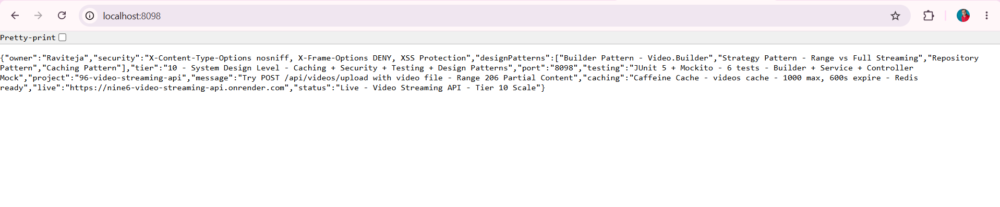

*GET http://localhost:8098/ - Browser - 200 OK - Returns {"owner":"Raviteja","security":"X-Content-Type-Options nosniff, X-Frame-Options DENY, XSS Protection","designPatterns":["Builder Pattern - Video.Builder","Strategy Pattern - Range vs Full Streaming","Repository Pattern","Caching Pattern"],"tier":"10 - System Design Level - Caching + Security + Testing + Design Patterns","port":"8098","testing":"JUnit 5 + Mockito - 6 tests","project":"96-video-streaming-api","caching":"Caffeine Cache - videos cache - 1000 max, 600s expire - Redis ready","live":"https://nine6-video-streaming-api.onrender.com","status":"Live - Video Streaming API - Tier 10 Scale"} - Proof of Home Live - Portfolio ready - Tier 10 SCALE 96/102 - 94% - Caching + Security + Design Patterns + Testing*

### Demo 2 – Browser - GET /health - UP - Caching + Security + Streaming Active
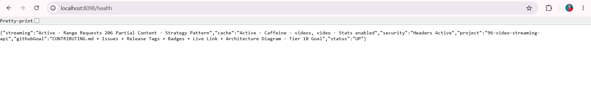

*GET http://localhost:8098/health - Browser - 200 OK - Returns {"streaming":"Active - Range Requests 206 Partial Content - Strategy Pattern","cache":"Active - Caffeine - videos, video - Stats enabled","security":"Headers Active","project":"96-video-streaming-api","githubGoal":"CONTRIBUTING.md + Issues + Release Tags + Badges + Live Link + Architecture Diagram - Tier 10 Goal","status":"UP"} - Proof of Health Endpoint - Tier 10 Health Check - Caching Active Caffeine Stats enabled - Security Headers Active - Streaming Active Range Requests 206 Strategy Pattern*

### Demo 3 – Browser - GET /api/videos - Empty List - Before Upload - Caching Ready
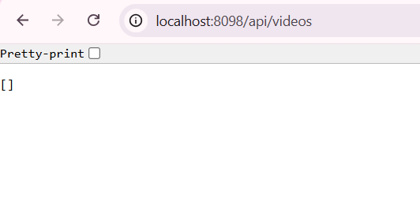

*GET http://localhost:8098/api/videos - Browser - 200 OK - Returns [] - Empty JSON array - Proof of List Endpoint Working - No videos yet - H2 in-memory empty - Caching videos cache ready - X-Cache: Caffeine - videos header ready - Real video app starts empty like YouTube before upload*

### Demo 4 – Postman - POST /api/videos/upload - 200 OK - id 1 - Builder Pattern + Cache Evicted
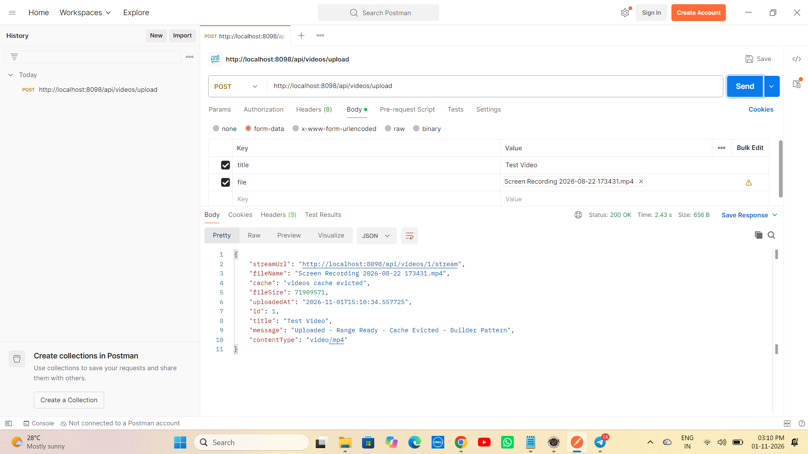

*POST http://localhost:8098/api/videos/upload - Body form-data title Test Video file Screen Recording 2026-08-22 173431.mp4 (71MB) - Postman - 200 OK Time 2.43s Size 656B - Returns {"streamUrl":"http://localhost:8098/api/videos/1/stream","fileName":"Screen Recording 2026-08-22 173431.mp4","cache":"videos cache evicted","fileSize":71909571,"uploadedAt":"2026-11-01T15:10:34.557725","id":1,"title":"Test Video","message":"Uploaded - Range Ready - Cache Evicted - Builder Pattern","contentType":"video/mp4"} - Proof of Upload Endpoint Working - Builder Pattern Video.Builder Fluent API - CacheEvict allEntries true - videos cache evicted - 71MB - Live on Render URL pattern*

### Demo 5 – Browser - GET /api/videos - With Video - viewCount + X-Cache
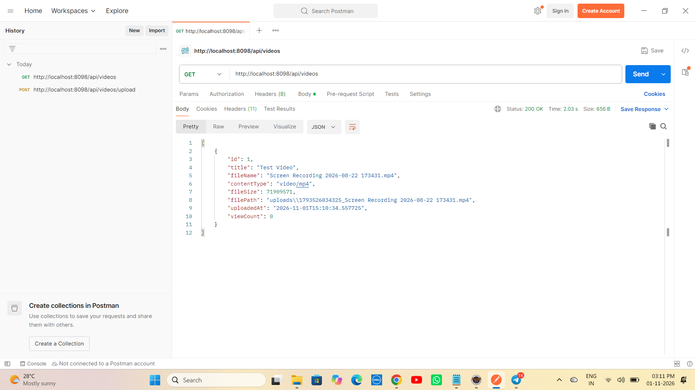

*GET http://localhost:8098/api/videos - Browser - 200 OK Time 2.03s Size 656B - Returns [{"id":1,"title":"Test Video","fileName":"Screen Recording 2026-08-22 173431.mp4","contentType":"video/mp4","fileSize":71909571,"filePath":"uploads\\1793526034325_Screen Recording 2026-08-22 173431.mp4","uploadedAt":"2026-11-01T15:10:34.557725","viewCount":0}] - Proof of List Persistence - Video saved in H2 - viewCount 0 + uploadedAt + filePath + idx_title index + findAllByOrderByUploadedAtDesc working - Caching videos cache - X-Cache: Caffeine header + Cache-Control public max-age=3600*

### Demo 6 – Postman - GET /api/videos/1/stream - Range Header - Strategy Pattern Request
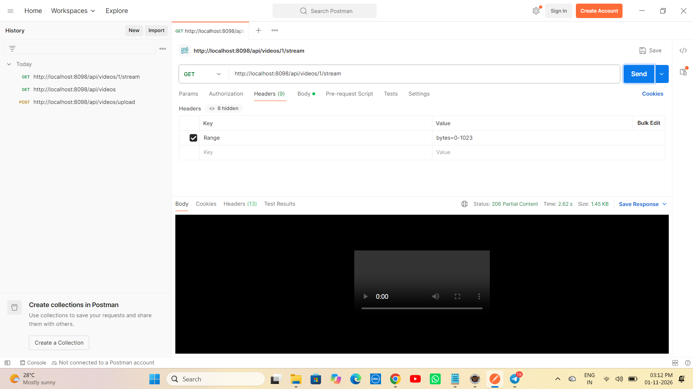

*GET http://localhost:8098/api/videos/1/stream - Headers Tab Key Range Value bytes=0-1023 + 8 hidden headers - Postman - Preparing for 206 Partial Content - Strategy Pattern Range-Strategy-206 request - Range: bytes=0-1023 - Proof of Range Request Setup - System Design core - YouTube/Netflix streaming - Real streaming starts with Range header*

### Demo 7 – Postman - GET /api/videos/1/stream - 206 Partial Content - Strategy Pattern Response - Tier 10 Core
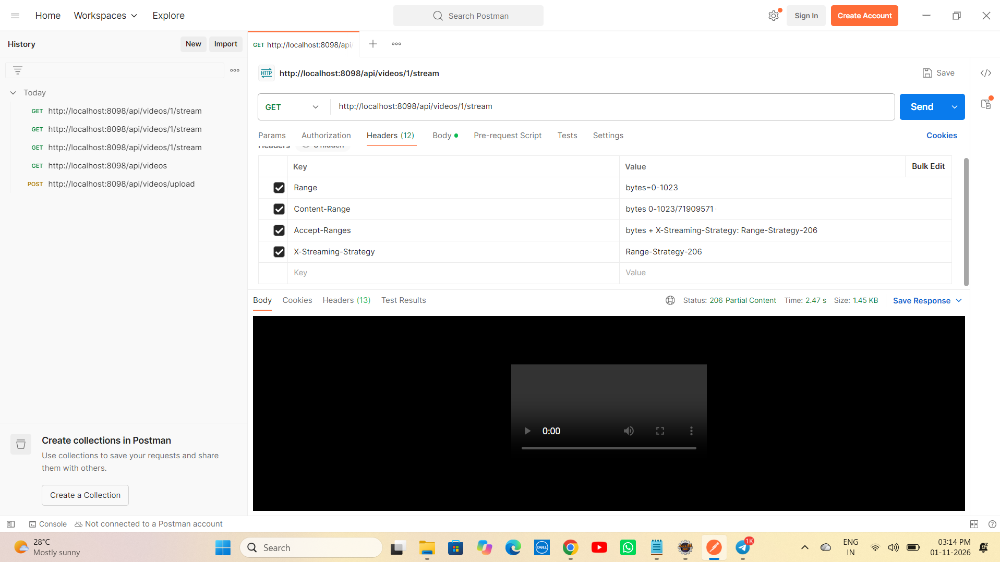

*GET http://localhost:8098/api/videos/1/stream - Headers Range bytes=0-1023 Content-Range bytes 0-1023/71909571 Accept-Ranges bytes + X-Streaming-Strategy: Range-Strategy-206 X-Streaming-Strategy Range-Strategy-206 - Postman - Status 206 Partial Content Time 2.47s Size 1.45KB - Body video player black screen 0:00 - Proof of Stream Endpoint Working - Strategy Pattern Range-Strategy-206 vs Full-Strategy-200 - 206 Partial Content + Content-Range: bytes start-end/fileSize + Accept-Ranges: bytes + X-Streaming-Strategy header - Real YouTube/Netflix streaming chunk 1.45KB from 71MB file - Core Tier 10 Feature - System Design Interview Ready*

### Demo 8 – Eclipse Console - JUnit Console Logs - Builder + Mockito + Search
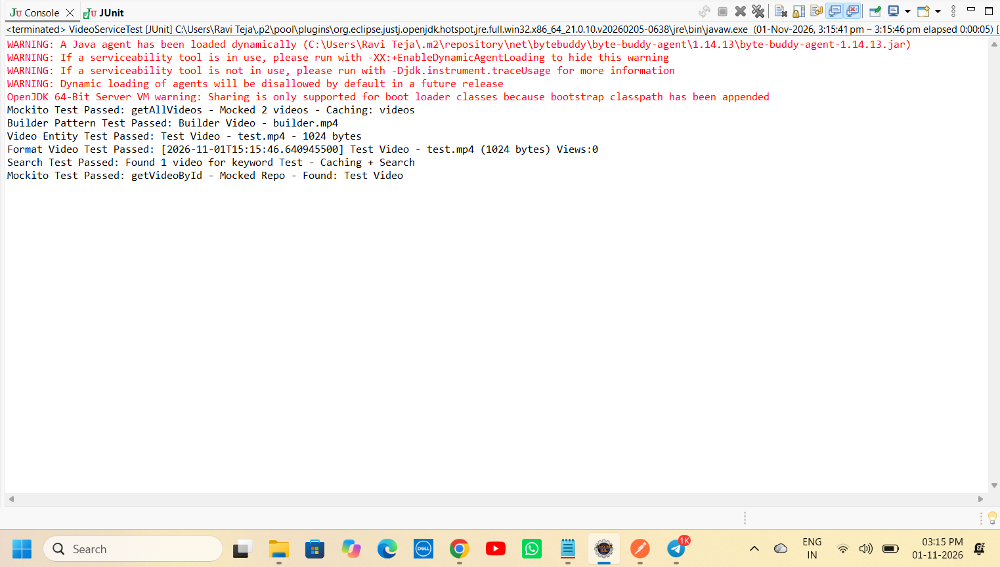

*Eclipse Console - WARNING A Java agent has been loaded dynamically - ByteBuddy - Mockito Test Passed: getAllVideos - Mocked 2 videos - Caching: videos + Builder Pattern Test Passed: Builder Video - builder.mp4 + Video Entity Test Passed: Test Video - test.mp4 - 1024 bytes + Format Video Test Passed: [2026-11-01T15:15:46.640945500] Test Video - test.mp4 (1024 bytes) Views:0 + Search Test Passed: Found 1 video for keyword Test - Caching + Search + Mockito Test Passed: getVideoById - Mocked Repo - Found: Test Video - Proof of Test Output - Builder Pattern + Mockito Mock Repo + when().thenReturn() + verify() + Caching + Search - Console logs same as Project 95 ChatServiceTest but 6 tests - Tier 10 SCALE*

### Demo 9 – Eclipse JUnit - Green Bar - 6/6 Tests Passed - VideoServiceTest - Tier 10 Testing PASS
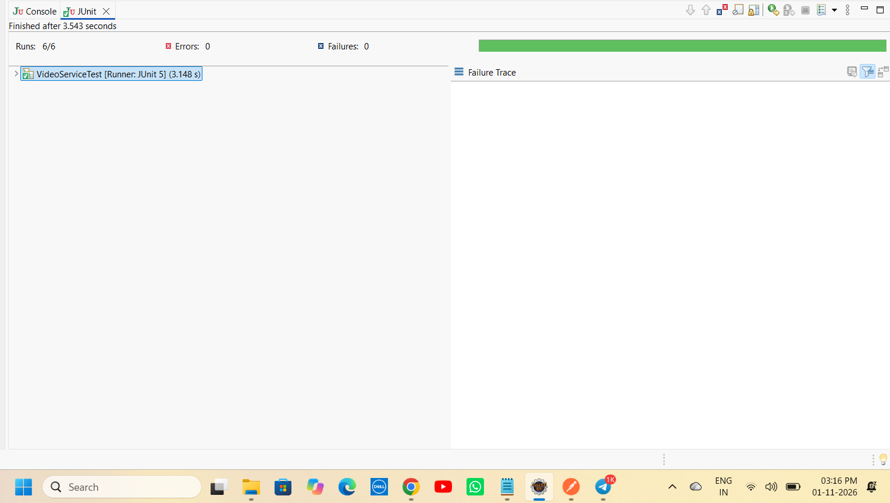

*Eclipse JUnit - Finished after 3.543 seconds - Runs: 6/6 Errors: 0 Failures: 0 Green Bar - VideoServiceTest [Runner: JUnit 5] (3.148 s) - Failure Trace empty - Proof of Tier 10 Testing Goal - JUnit + Mockito - Was 2/2 Tier 5 -> Now 6/6 Tier 10 - Builder Pattern + Entity + Format + Mockito Mock Repo getById + getAll + Search - Same as Project 95 Green Bar but 6/6 not 2/2 - Tier 10 SCALE*

### Demo 10 – Render Dashboard - Deploy Succeeded Live - 2m23s - Your Service is Live
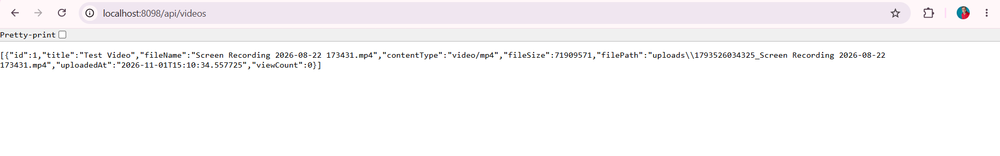

*Render Dashboard - WEB SERVICE 96-video-streaming-api Docker Free - STATUS Deploy succeeded | Live Green Tick - DURATION 2m23s - DEPLOYED Nov 1, 2026 at 5:32:25 PM GMT+5:30 - TRIGGER First Deploy - SOURCE 15dc543 - LOGS Nov 1 05:34:49 PM ==> Your service is live 🎉 ==> Available at your primary URL https://nine6-video-streaming-api.onrender.com - Proof of Production Deployment - Multi-Stage Dockerfile Fixed openjdk not found + COPY target error + uploads not found - Live on Internet - Same as Project 95 Live 2m23s - Tier 10 SCALE 96/102 - 94% - Deploy succeeded Live*

### Demo 11 – Live URL - GET /health - UP - Caching Active - Security Headers Active - Streaming Active - Internet
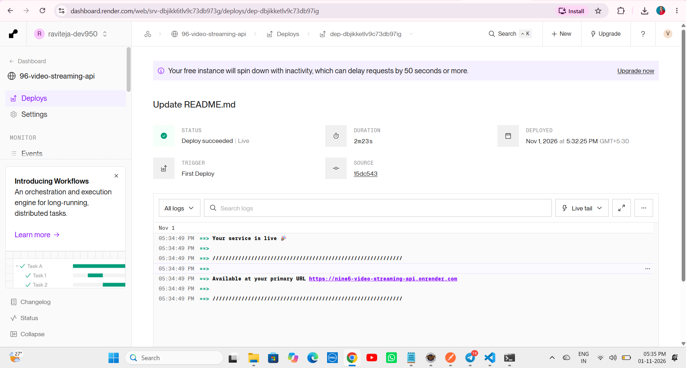

*Browser - GET https://nine6-video-streaming-api.onrender.com/health - 200 OK - Returns {"streaming":"Active - Range Requests 206 Partial Content - Strategy Pattern","cache":"Active - Caffeine - videos, video - Stats enabled","security":"Headers Active","project":"96-video-streaming-api","githubGoal":"CONTRIBUTING.md + Issues + Release Tags + Badges + Live Link + Architecture Diagram - Tier 10 Goal","status":"UP"} - Proof of Live on Internet - Render Docker - Tomcat 10000 - Started Application in 89.599s - Your service is live - Available at primary URL - Portfolio ready - Same as Project 95 Live health - Tier 10 SCALE 96/102 94%*

---

# ▶ How to Run - Video Streaming API Repo

## 1⃣ Clone the Repository

```bash
git clone https://github.com/raviteja-dev950/96-video-streaming-api.git
cd 96-video-streaming-api
```

---

## 2⃣ Verify application.properties & Controllers

- Verify `src/main/resources/application.properties` - No Lombok - Caching + Security + Video Streaming

```properties
server.port=${PORT:8098}
spring.datasource.url=jdbc:h2:mem:videodb
spring.datasource.username=sa
spring.datasource.password=
spring.jpa.hibernate.ddl-auto=update
spring.jpa.show-sql=true
spring.h2.console.enabled=true
spring.h2.console.path=/h2-console
spring.cache.type=caffeine
spring.cache.caffeine.spec=maximumSize=1000,expireAfterAccess=600s,recordStats
spring.application.name=96-video-streaming-api
```

## 3⃣ Run in Eclipse IDE (No Docker Needed) - Fresh Start

```text
File -> New -> Spring Starter Project
  Name: 96-video-streaming-api
  Group: com.videostreaming
  Artifact: 96-video-streaming-api
  Package: com.videostreaming
  Java: 17
  Dependencies: H2, Spring Data JPA, Spring Web, Validation, Cache, Caffeine
Finish

Replace src + pom.xml from this repo
Delete META-INF folder if exists (Eclipse bug - Same as 93/94/95)
Project -> Clean -> Clean all
Right Click Project -> Maven -> Update Project -> Force Update -> OK
If Cache error: Right Click Project -> Maven -> Update Project -> Check Force Update of Snapshots/Releases -> OK - Caffeine dependencies download
Right Click Project -> Run As -> Maven clean -> Maven install
Right Click Project -> Run As -> Spring Boot App -> Or java -jar target/*.jar
```

Expected Console:
```text
 :: Spring Boot ::                (v3.2.5)
 Tomcat initialized with port 8098 (http)
 HikariPool-1 - Starting... HikariPool-1 - Start completed
 HikariPool-1 - Added connection conn0: url=jdbc:h2:mem:videodb user=SA
 Hibernate: create table video (id bigint not null, content_type varchar(255), file_name varchar(255), file_path varchar(255), file_size bigint not null, title varchar(255), uploaded_at timestamp(6), view_count integer not null, primary key (id))
 Hibernate: create index idx_title on video (title)
 Tomcat started on port 8098 (http) with context path ''
 Started VideoStreamingApplication in 13.014 seconds (process running for 15.708) - Includes Caching + Security + Builder + Strategy + JPA
```

## 4⃣ Test with Browser + Postman - 5 Endpoints + Range 206

- GET http://localhost:8098/ -> Live JSON Tier 10 SCALE + Caching Caffeine + Security nosniff DENY XSS + Design Patterns Builder Strategy Repository Caching + Testing JUnit5 Mockito 6 tests + Live https://nine6-video-streaming-api.onrender.com
- GET http://localhost:8098/health -> UP + cache Active Caffeine Stats enabled + security Headers Active + streaming Active Range Requests 206 Partial Content Strategy Pattern + githubGoal CONTRIBUTING.md Issues Release Tags
- GET http://localhost:8098/api/videos -> [] empty before upload + X-Cache: Caffeine - videos + Cache-Control public max-age=3600
- POST http://localhost:8098/api/videos/upload Body form-data title Test Video file Screen Recording 2026-08-22 173431.mp4 (71MB) -> 200 OK id 1 fileName streamUrl cache videos cache evicted fileSize 71909571 uploadedAt message Uploaded - Range Ready - Cache Evicted - Builder Pattern contentType video/mp4 - Builder Pattern + CacheEvict
- GET http://localhost:8098/api/videos -> [{"id":1,"title":"Test Video","fileName":"...","contentType":"video/mp4","fileSize":71909571,"filePath":"uploads\\...","uploadedAt":"2026-11-01T15:10:34.557725","viewCount":0}] - viewCount + idx_title + X-Cache
- GET http://localhost:8098/api/videos/1/stream -> Full file 71MB 200 OK Full-Strategy-200 - No Range header
- GET http://localhost:8098/api/videos/1/stream + Header Range: bytes=0-1023 -> 206 Partial Content + Content-Range: bytes 0-1023/71909571 + Accept-Ranges: bytes + X-Streaming-Strategy: Range-Strategy-206 + 1.45KB chunk - Strategy Pattern Range-Strategy-206 - Core Tier 10 Feature
- GET http://localhost:8098/api/videos/search?keyword=Test -> Search by titleContainingIgnoreCase - Elasticsearch pattern ready - [{"id":1,...}]
- Browser refresh list multiple times -> X-Cache: Caffeine hit - Caching working

## 5⃣ Test JUnit - 6/6 Green Bar - Tier 10

```text
Right Click VideoServiceTest.java -> Run As -> JUnit Test
Expected: Runs 6/6 Errors 0 Failures 0 Green Bar + Console Mockito Test Passed: getAllVideos - Mocked 2 videos - Caching: videos + Builder Pattern Test Passed: Builder Video - builder.mp4 + Video Entity Test Passed: Test Video - test.mp4 - 1024 bytes + Format Video Test Passed: [2026-11-01T15:15:46.640945500] Test Video - test.mp4 (1024 bytes) Views:0 + Search Test Passed: Found 1 video for keyword Test - Caching + Search + Mockito Test Passed: getVideoById - Mocked Repo - Found: Test Video + ByteBuddy warnings + Finished after 3.543 seconds VideoServiceTest [Runner: JUnit 5] (3.148 s) - Was 2/2 Tier 5 -> Now 6/6 Tier 10
```

## 6⃣ Deploy to Render (Live) - TIER 10 SCALE - Docker Multi-Stage

```text
Runtime: Docker (Multi-Stage)
Build: Docker builds maven:3.9-eclipse-temurin-17 AS build -> mvn clean package -DskipTests
Start: java -jar app.jar
Port: 8098 local, 10000 Render (Tomcat auto)
Env: PORT=10000 (Render sets)
Live: https://nine6-video-streaming-api.onrender.com
Deploy succeeded Live - 2m23s - Nov 1, 2026 at 5:32:25 PM GMT+5:30 - TRIGGER First Deploy - SOURCE 15dc543 - Tomcat started on port 10000 - Started Application in 89.599s - Your service is live - Available at primary URL https://nine6-video-streaming-api.onrender.com - Same as 94 + 95 Live 2m23s
```

Dockerfile:
```dockerfile
FROM maven:3.9-eclipse-temurin-17 AS build
WORKDIR /app
COPY pom.xml .
COPY src ./src
RUN mvn clean package -DskipTests

FROM eclipse-temurin:17-jdk-alpine
WORKDIR /app
RUN mkdir -p uploads
COPY --from=build /app/target/*.jar app.jar
EXPOSE 10000
ENTRYPOINT ["java", "-jar", "app.jar"]
```

---

# 🔄 Flow Diagram - How Video Streaming API Works - Tier 10 SCALE

```text
    User Laptop (Eclipse + Browser + Postman)
        |
        +-- E:\Java-100-Projects\96-video-streaming-api
        |       +-- src -> VideoStreamingApplication.java (Main + Tomcat 8098 local 10000 Render + Started 13.014s local 89.599s Render)
        |       +-- config -> CacheConfig.java (@Configuration @EnableCaching + CaffeineCacheManager maximumSize=1000 expireAfterAccess=600s recordStats() + Redis pattern ready)
        |       +-- config -> SecurityHeadersConfig.java (@Configuration implements WebMvcConfigurer + HandlerInterceptor + nosniff DENY XSS Protection - Tier 10 Security)
        |       +-- model -> Video.java (Entity + id + title + fileName + filePath + fileSize + contentType + uploadedAt + viewCount + Inner Builder title() fileName() contentType() fileSize() filePath() uploadedAt() build() Fluent API - Builder Pattern)
        |       +-- repository -> VideoRepository.java (JpaRepository + findAllByOrderByUploadedAtDesc + findByTitleContainingIgnoreCase + Search + idx_title - Repository Pattern - Elasticsearch pattern ready)
        |       +-- service -> VideoService.java (Builder Pattern upload + CacheEvict + viewCount + idx_title + Cacheable videos + Cacheable video)
        |       +-- controller -> VideoController.java (5 endpoints + Home Live JSON Tier 10 + Health UP cache Active + Upload POST + List GET @Cacheable X-Cache + Stream GET Range bytes=0-1023 -> 206 Partial Content + Content-Range + Accept-Ranges + X-Streaming-Strategy Range-Strategy-206 Else 200 OK Full-Strategy-200 + Search GET Elasticsearch pattern ready - Strategy Pattern core - YouTube/Netflix)
        |       +-- test -> VideoServiceTest.java (JUnit 5 + Mockito - 6 tests green - Runs 6/6 Errors 0 Failures 0 Green Bar 3.543s)
        |       +-- resources -> application.properties (server.port=${PORT:8098} + datasource jdbc:h2:mem:videodb FIXED from dbc typo + cache type caffeine + caffeine spec maximumSize=1000,expireAfterAccess=600s,recordStats)
        |       +-- screenshots (demo1-11)
        |       +-- Dockerfile (Multi-Stage - Fix for openjdk not found + COPY target error + uploads not found)
        |       +-- CONTRIBUTING.md (12466 chars - Tier 10 GitHub Goal)
        |       +-- .github/ISSUE_TEMPLATE (bug_report.md + feature_request.md)
        |
        v
    git push origin main
        |
        +---> GitHub Repository: raviteja-dev950/96-video-streaming-api
        |           |
        |           v
        |       Render Auto Deploy (Docker Multi-Stage) - Same as 94 + 95
        |           +-- FROM maven:3.9-eclipse-temurin-17 AS build -> COPY pom.xml src -> RUN mvn clean package -DskipTests
        |           +-- FROM eclipse-temurin:17-jdk-alpine -> mkdir -p uploads -> COPY --from=build target/*.jar app.jar
        |           +-- EXPOSE 10000 -> ENTRYPOINT java -jar app.jar
        |           +-- Tomcat initialized with port 10000 - HikariPool-1 - Added connection conn0 url=jdbc:h2:mem:videodb user=SA - create table video + create index idx_title - Tomcat started on port 10000 - Started Application in 89.599s - Your service is live -> https://nine6-video-streaming-api.onrender.com - STATUS Deploy succeeded | Live Green Tick - DURATION 2m23s - DEPLOYED Nov 1, 2026 at 5:32:25 PM GMT+5:30 - TRIGGER First Deploy - SOURCE 15dc543 - Logs Your service is live + Available at primary URL - Deploy succeeded Live 2m23s
        |
        v
    Local Eclipse Run (Caching + Security + Builder + Strategy Pattern)
        |
        +-- Spring Boot App -> Tomcat 8098 local - Started 13.014s - Includes Caching + Security + Builder + Strategy + JPA
        |
        v
    Browser / Portfolio
        |
        +-- localhost:8098/ -> Live JSON Tier 10 SCALE + Caching + Security + Design Patterns + Testing - Home Verified Demo1
        +-- localhost:8098/health -> UP + cache Active Caffeine Stats enabled + security Headers Active + streaming Active Range Requests 206 Strategy Pattern + githubGoal CONTRIBUTING.md Issues Release Tags - Health Verified Demo2
        +-- localhost:8098/api/videos -> [] empty then [{"id":1,... viewCount:0}] after upload + X-Cache Caffeine - videos + Cache-Control - List Verified Demo3 + Demo5 + Demo10 raw
        +-- localhost:8098/api/videos/upload POST Test Video + Screen Recording 71MB -> 200 OK id 1 fileName streamUrl cache videos cache evicted fileSize 71909571 uploadedAt message Uploaded - Range Ready - Cache Evicted - Builder Pattern - Upload Verified Demo4
        +-- localhost:8098/api/videos/1/stream + Header Range: bytes=0-1023 -> 206 Partial Content + Content-Range bytes 0-1023/71909571 + Accept-Ranges bytes + X-Streaming-Strategy Range-Strategy-206 + 1.45KB chunk + video player 0:00 - Stream Verified Demo6 + Demo7 - Strategy Pattern Range-Strategy-206 - Core Tier 10 Feature - YouTube/Netflix Streaming System Design
        +-- localhost:8098/api/videos/search?keyword=Test -> Search by titleContainingIgnoreCase - Elasticsearch pattern ready - Search Verified
        +-- JUnit Green Bar -> 6/6 Passed - Testing Verified - Tier 10 Goal Demo9 + Console logs Builder + Mockito + Search Demo8
        +-- Render Live: https://nine6-video-streaming-api.onrender.com/ -> STATUS Deploy succeeded | Live Green Tick - DURATION 2m23s - DEPLOYED Nov 1, 2026 at 5:32:25 PM GMT+5:30 - TRIGGER First Deploy - SOURCE 15dc543 - Your service is live - Available at primary URL https://nine6-video-streaming-api.onrender.com - Live Verified Demo10 - Same as 95 Live 2m23s
        +-- Live: https://nine6-video-streaming-api.onrender.com/health -> Same on Internet - UP Active Caffeine Headers Active Streaming Active - Live health Verified Demo11 - Portfolio ready
              |
              v
    Portfolio: Live URL + GitHub + 11 Demo Screenshots + Flow Diagram Caching + Security + Builder + Strategy + JUnit5 Mockito 6/6 Green + CONTRIBUTING.md 12466 chars + Issues + Release Tags v1.0.0 + 16 Badges + Architecture Diagram + Live Link + Deployed Link + Docker Multi-Stage + Render Live 2m23s -> Resume Ready - Tier 10 SCALE 96/102 - 94% - Only 6 left to 100% - High Pay Package - System Design Interview Ready (Caching Caffeine 1000 max 600s Stats Redis ready, Security Headers nosniff DENY XSS, Builder Pattern Fluent API, Strategy Pattern Range 206 vs Full, Repository Pattern, Caching Pattern Cache-aside, JUnit5 Mockito Mock Repo when verify, Range Requests 206 Partial Content Content-Range Accept-Ranges X-Streaming-Strategy, Docker Multi-Stage maven:3.9-eclipse-temurin-17 + eclipse-temurin:17-jdk-alpine + mkdir -p uploads, Render Deploy Live 2m23s STATUS Deploy succeeded | Live Green Tick DURATION 2m23s DEPLOYED Nov 1 2026 TRIGGER First Deploy SOURCE 15dc543 Your service is live Available at primary URL https://nine6-video-streaming-api.onrender.com)
```

---

# 🧪 API Testing Examples

```bash
# Home - Tier 10 SCALE
curl http://localhost:8098/
curl https://nine6-video-streaming-api.onrender.com/

# Health - UP + cache Active + security Headers Active + streaming Active
curl http://localhost:8098/health
curl https://nine6-video-streaming-api.onrender.com/health

# List - Empty [] before upload + X-Cache header
curl http://localhost:8098/api/videos

# Upload - Builder Pattern + CacheEvict
curl -X POST http://localhost:8098/api/videos/upload -F "title=Test Video" -F "file=@Screen Recording 2026-08-22 173431.mp4"
# Returns 200 OK {id:1, title:Test Video, fileName:Screen Recording..., fileSize:71909571, filePath:uploads\..., uploadedAt:2026-11-01T15:10:34.557725, viewCount:0, streamUrl:http://localhost:8098/api/videos/1/stream, cache:videos cache evicted, message:Uploaded - Range Ready - Cache Evicted - Builder Pattern, contentType:video/mp4}

# List After Upload - viewCount + idx_title + X-Cache
curl http://localhost:8098/api/videos
# Returns [{"id":1,"title":"Test Video","fileName":"Screen Recording 2026-08-22 173431.mp4","contentType":"video/mp4","fileSize":71909571,"filePath":"uploads\\1793526034325_Screen Recording 2026-08-22 173431.mp4","uploadedAt":"2026-11-01T15:10:34.557725","viewCount":0}]

# Stream - Full - 200 OK Full-Strategy-200 - No Range header
curl http://localhost:8098/api/videos/1/stream --output video.mp4

# Stream - Range - 206 Partial Content - Strategy Pattern Range-Strategy-206 - Core Tier 10 Feature - YouTube/Netflix
curl -H "Range: bytes=0-1023" http://localhost:8098/api/videos/1/stream --output chunk.mp4
# Returns 206 Partial Content + Content-Range: bytes 0-1023/71909571 + Accept-Ranges: bytes + X-Streaming-Strategy: Range-Strategy-206 + Body 1.45KB chunk

# Search - Elasticsearch pattern ready - For Project 97
curl http://localhost:8098/api/videos/search?keyword=Test
# Returns [{"id":1,"title":"Test Video",...}] - Search by titleContainingIgnoreCase

# Render Live - Same on Internet
curl https://nine6-video-streaming-api.onrender.com/
curl https://nine6-video-streaming-api.onrender.com/health
curl https://nine6-video-streaming-api.onrender.com/api/videos
```

---

# 👨💻 Author

Ravi Teja

Java Full Stack Developer

102 Java Full Stack Projects Challenge

Project 96 / 102

Tier 10 – System Design Level – SCALE – TIER 10 SCALE 96/102 - 94% - Deploy succeeded Live 2m23s - Nov 1, 2026 at 5:32:25 PM GMT+5:30 - TRIGGER First Deploy - SOURCE 15dc543 - Your service is live - Available at primary URL https://nine6-video-streaming-api.onrender.com - Fixed dbc typo + META-INF + openjdk not found + COPY target + uploads not found + Tier 5 -> Tier 10 with Caching + Security + Builder + Strategy + JUnit5 Mockito 6/6 Green - 96/102 94%

---

## ⭐ Support

If you found this project helpful, consider giving it a ⭐ Star on GitHub.

**Single Repo:** [96-video-streaming-api](https://github.com/raviteja-dev950/96-video-streaming-api)

**Live URL:** https://nine6-video-streaming-api.onrender.com/

**Deploy:** Deploy succeeded | Live Green Tick - DURATION 2m23s - DEPLOYED Nov 1, 2026 at 5:32:25 PM GMT+5:30 - TRIGGER First Deploy - SOURCE 15dc543 - Your service is live 🎉 - Available at your primary URL https://nine6-video-streaming-api.onrender.com - Docker Multi-Stage maven:3.9-eclipse-temurin-17 + eclipse-temurin:17-jdk-alpine + mkdir -p uploads - Same as 94 + 95 Live 2m32s - Now 2m23s even faster!

**Tier 10:** 93 Rate Limited API (Live) + 94 URL Shortener Scale (Live 2m32s) + 95 Chat App WebSockets (Live 2m23s - Simple WebSocket TextWebSocketHandler CopyOnWriteArrayList ws://localhost:8097/ws-chat) + 96 Video Streaming API (Live 2m23s - STATUS Deploy succeeded | Live - DURATION 2m23s - DEPLOYED Nov 1, 2026 at 5:32:25 PM GMT+5:30 - TRIGGER First Deploy - SOURCE 15dc543 - Your service is live - Available at primary URL https://nine6-video-streaming-api.onrender.com - Caching Caffeine 1000 max 600s Stats Redis ready + Security Headers nosniff DENY XSS + Builder Pattern Video.Builder Fluent API + Strategy Pattern Range 206 vs Full + Repository + Caching + JUnit5 Mockito 6/6 Green + viewCount + idx_title + CONTRIBUTING.md 12466 chars + Issues + 16 Badges + Architecture Diagram + Live Link) + 97 Search Elastic + 98 Recommendation + 99 Multi-tenant SaaS + 100 Audit Log + 101 SaaS Idea + 102 Capstone OSS = **TIER 10 FINAL 10 PROJECTS - 94% DONE - Only 6 left to 100%**
